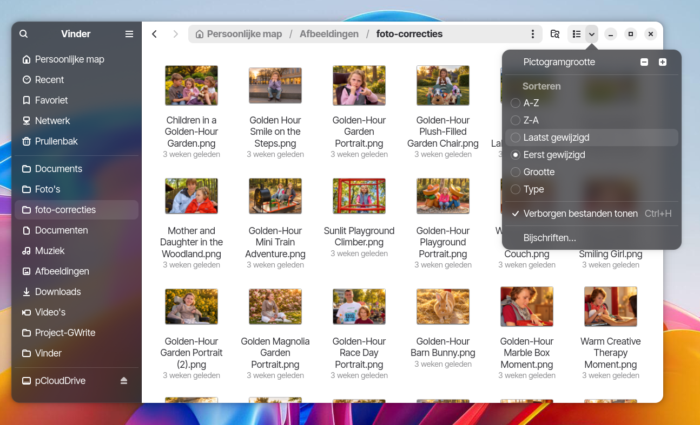

# Vinder

Vinder is a GNOME file manager based on [GNOME Files (Nautilus)](https://apps.gnome.org/Nautilus/). It adds an Interface dialog with theme and blur controls.



## Computer

Select **Computer** at the top of the sidebar to browse the filesystem root. In the Flatpak, Vinder opens the host filesystem root when Flatpak exposes it.

## Appearance

Open the main menu and choose **Interface**. Select **Light**, **Dark**, or **Dark and Light** for a dark sidebar and light file area. Turn on **Blur** to give the sidebar and popup windows a translucent background, then adjust **Opacity (%)** and **Blur Strength**. **Blur Menus** controls menus and popovers separately while blur is enabled.

Desktop backdrop blur requires GNOME 51 or later.

## Build and run

Install Meson, Ninja, a C toolchain, the Blueprint compiler, and the Nautilus development dependencies for your distribution. The runtime uses Bubblewrap, LocalSearch, and xdg-user-dirs-gtk for file management features.

From the repository root, build and install into a private prefix:

```sh
meson setup build -Dprofile=Devel --prefix="$PWD/local"
meson compile -C build
meson install -C build
XDG_DATA_DIRS="$PWD/local/share:${XDG_DATA_DIRS:-/usr/local/share:/usr/share}" \
  "$PWD/local/bin/nautilus" --new-window
```

The development profile uses the separate application ID `org.gnome.Nautilus.Devel`.

## Source and licensing

Vinder builds on the work of the [GNOME Nautilus contributors](https://gitlab.gnome.org/GNOME/nautilus). See [LICENSE](LICENSE) for licensing terms. Report Vinder issues on [GitHub](https://github.com/paullinux-gn/vinder/issues).

## Flatpak

Download `Vinder-1.3-x86_64.flatpak` from the [GitHub release](https://github.com/paullinux-gn/vinder/releases/tag/v1.3). The bundle uses the GNOME 51 runtime from Flathub.

```sh
flatpak install --user Vinder-1.3-x86_64.flatpak
flatpak run io.github.paullinux_gn.Vinder
```

The Flatpak has its own application ID and can be installed alongside GNOME Files.

## Nautilus backend fixes

Vinder's Flatpak builds Nautilus-derived code from the Vinder checkout. Stock
Nautilus updates and GNOME runtime updates do not replace Vinder's application
code. Build and publish Vinder releases from reviewed Vinder revisions.

Run `build-aux/review-nautilus-upstream.sh` from a Vinder branch to fetch GNOME
Nautilus into a dedicated Git ref and list upstream commits with their changed
files. The command leaves your branch and working tree alone.

Review individual fixes for file operations, filesystem and mount handling,
search, and thumbnailing. Inspect each patch and its dependencies with
`git show <commit>`. The review list also includes frontend changes, so read
the diff before deciding what to bring over.

On a clean branch based on Vinder, cherry-pick a self-contained fix with
`git cherry-pick -x <commit>`. For mixed patches, port the backend change by
hand and record the upstream commit in the commit message. Keep Vinder on its
fork by avoiding whole-branch merges and rebases onto Nautilus.

Before releasing a backport, run the tests for the affected code and build the
Vinder Flatpak. Check the feature the patch fixes, the Computer sidebar entry,
host file launching and thumbnails, and the Interface themes and blur controls
in the resulting build.
